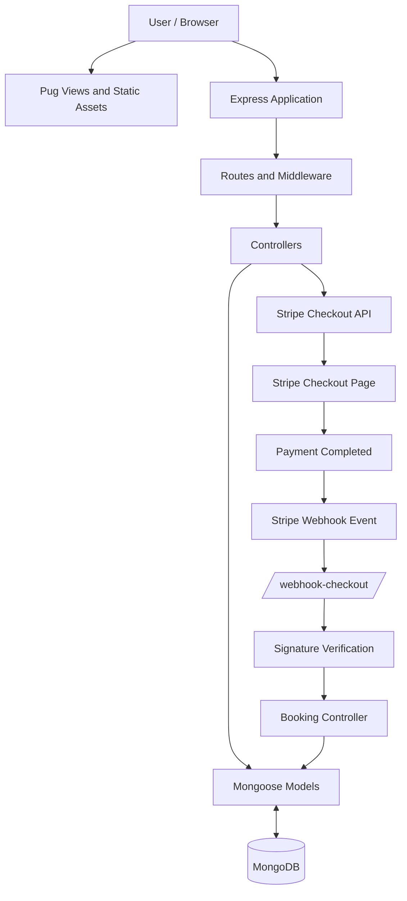

# Natours | Tour Booking Platform

**Developed by Moses Ifunanya Nobei**

Natours is a full-stack tour booking application built with Node.js,
Express, MongoDB, and Pug. Users can explore tours, view tour details,
and book tours through Stripe Checkout.

The project demonstrates backend development, RESTful API design,
authentication and authorization, database modeling, server-side
rendering, and payment integration.

## Table of Contents

- [Features](#features)
- [Technology Stack](#technology-stack)
- [System Architecture](#system-architecture)
- [Project Structure](#project-structure)
- [Getting Started](#getting-started)
- [Stripe Webhook Setup](#stripe-webhook-setup)
- [API Routes](#api-routes)
- [Security](#security)
- [Future Improvements](#future-improvements)
- [Acknowledgements](#acknowledgements)
- [About the Developer](#about-the-developer)

## Features

- **Tour Discovery:** Browse available tours and view tour details.
- **Authentication and Authorization:** Secure routes and restrict
  access according to user roles.
- **Tour Management:** Create, retrieve, update, and delete tour
  records through the API.
- **Booking Workflow:** Store bookings in MongoDB after successful
  payment processing.
- **Stripe Checkout:** Integrate Stripe Checkout for test-mode
  payments.
- **Webhook Handling:** Verify Stripe webhook signatures and process
  completed Checkout Sessions.
- **Reviews and Ratings:** Support tour reviews and ratings.
- **User Accounts:** Manage user accounts and profile information.
- **Server-Side Rendering:** Render dynamic pages with Pug.
- **Security Middleware:** Apply security headers, rate limiting, and
  request data sanitization.

## Technology Stack

Area Technologies

---

Runtime Node.js
Backend Express.js
Database MongoDB, Mongoose
Views and UI Pug, HTML, CSS, JavaScript
Payments Stripe Checkout, Stripe webhooks
Authentication JSON Web Tokens (JWT), cookies
Development tools Nodemon, Morgan, Postman, MongoDB Compass

## System Architecture

The diagram below illustrates the main request and payment flow in the
application.



### Main Components

- **Express application:** Handles incoming requests and coordinates
  middleware and routes.
- **Routes and middleware:** Direct requests to the appropriate
  controllers and apply authentication, authorization, and security
  checks.
- **Controllers:** Contain application logic for tours, users,
  reviews, bookings, and payment processing.
- **Mongoose models:** Define and interact with the application's
  MongoDB data.
- **MongoDB:** Stores application data such as tours, users, reviews,
  and bookings.
- **Stripe Checkout:** Provides the hosted checkout experience for
  test payments.
- **Stripe webhook:** Receives Stripe events, verifies their
  signatures, and triggers booking creation after a completed, paid
  Checkout Session.

## Project Structure

```text
natours/
├── controllers/
├── models/
├── routes/
├── utils/
├── views/
├── public/
│   ├── css/
│   ├── img/
│   └── js/
├── app.js
├── server.js
├── config.env
└── package.json
```

This is a high-level overview. Exact files and folders may vary with the
current repository implementation.

## Getting Started

### Prerequisites

- Node.js and npm
- MongoDB or a MongoDB Atlas database
- A Stripe account for test payments

### Installation

1.  Clone your repository:

    ```bash
    git clone YOUR_REPOSITORY_URL
    ```

2.  Move into the project directory:

    ```bash
    cd natours
    ```

3.  Install dependencies:

    ```bash
    npm install
    ```

4.  Create a `config.env` file in the project root and add the
    environment variables required by your application. For example:

    ```env
    NODE_ENV=development
    PORT=3000
    DATABASE=YOUR_MONGODB_CONNECTION_STRING
    DATABASE_PASSWORD=YOUR_DATABASE_PASSWORD
    JWT_SECRET=YOUR_JWT_SECRET
    JWT_EXPIRES_IN=90d
    STRIPE_SECRET_KEY=YOUR_STRIPE_SECRET_KEY
    STRIPE_WEBHOOK_SECRET=YOUR_STRIPE_WEBHOOK_SECRET
    ```

    Add any other variables required by your local configuration. Never
    commit real passwords, API keys, database credentials, or signing
    secrets to GitHub.

5.  Start the application using the script configured in `package.json`:

    ```bash
    npm run start
    ```

6.  Open the application:

    ```text
    http://localhost:3000
    ```

## Stripe Webhook Setup

For local payment testing, install and authenticate the Stripe CLI.
Start a listener for completed Checkout Sessions:

```bash
stripe listen --events checkout.session.completed --forward-to http://localhost:3000/webhook-checkout
```

Copy the signing secret printed by the CLI into `STRIPE_WEBHOOK_SECRET`
in `config.env`. Restart the application after changing the environment
variable so the updated value is loaded.

Use Stripe test mode while developing. Verify that the webhook receives
the event and that a booking is saved in MongoDB after successful
payment.

## API Routes

Resource Base route

---

Tours `/api/v1/tours`
Users `/api/v1/users`
Reviews `/api/v1/reviews`
Bookings `/api/v1/bookings`

The endpoints available to a user depend on the authentication and
authorization rules configured in the application.

## Security

- Keep credentials and environment variables out of version control.
- Verify Stripe webhook signatures before processing events.
- Protect routes with authentication and authorization middleware.
- Apply HTTP security headers and request rate limiting.
- Sanitize incoming data and handle errors consistently.
- Consider webhook idempotency to prevent duplicate bookings when
  Stripe retries events.

## Future Improvements

- Add automated tests for booking and payment workflows.
- Improve webhook idempotency and duplicate-event handling.
- Expand booking history and account management.
- Document API endpoints and expected responses.
- Add screenshots or a product demo video.

## Acknowledgements

This project is inspired by the Natours application developed as part of
Jonas Schmedtmann's Node.js course. The repository includes the
developer's ongoing implementation and modifications.

## About the Developer

**Moses Ifunanya Nobei** is a software developer with experience and
interests in JavaScript development, backend and full-stack development,
data analysis, and blockchain technologies.

Natours reflects practical work with Node.js, Express, MongoDB, Pug, and
Stripe payment integration.

- **GitHub:** [mosesifunanya](https://github.com/mosesifunanya)
- **LinkedIn:** [Moses Ifunanya
  Nobei](https://www.linkedin.com/in/mosesifunanya/)

---

If you find this project useful, explore the code and follow the
repository for future improvements.
